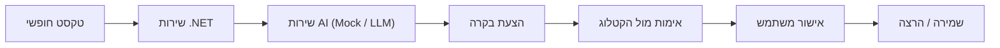

# ארכיטקטורה ומנגנון הבקרות

## 1. סקירה
המערכת מאפשרת להגדיר בקרות איכות נתונים **בלי לכתוב SQL**. הבקרה נשמרת כהגדרה עסקית (JSON), והמערכת מתרגמת אותה לשאילתה ומריצה אותה. רשומה שעומדת בתנאי הבקרה נחשבת **חריגה**.

| רכיב | טכנולוגיה | תפקיד |
|---|---|---|
| Frontend | Angular | בניית בקרות, הרצה, תצוגת תוצאות, עוזר AI |
| Backend | .NET 10 (Api / BL / DAL) | ולידציה, בניית שאילתה, הרצה, שמירה |
| שירות AI | Python (FastAPI) | הפיכת טקסט חופשי להצעת בקרה |
| בסיס נתונים | SQL Server | נתוני העסק (`dbo`) + קטלוג ובקרות (`ctl`) |

## 2. שכבות ה-Backend
```
Api  ──►  BL  ◄──  DAL
```
| שכבה | תפקיד | מכילה |
|---|---|---|
| **BL** | לוגיקה עסקית, ללא תלות בתשתית | הגדרות בקרה, קטלוג, ולידציה, בניית שאילתה, הרצה, חוזי AI, והממשקים `IControlRepository`, `ICatalogProvider`, `IQueryExecutor`, `IAiControlProvider` |
| **DAL** | מימוש הממשקים מול התשתית | גישה ל-SQL Server (Dapper), טעינת קטלוג, לקוח HTTP לשירות ה-AI |
| **Api** | חשיפה החוצה | Controllers דקים, טיפול אחיד בשגיאות (`{status,title,errors[]}`), CORS, Swagger |

כיוון התלות: Api ו-DAL מפנים ל-BL. ה-BL לא מכיר את ה-DAL ולא את ה-Api, ולכן אפשר להחליף מסד נתונים או מודל AI בלי לגעת בלוגיקה.

## 3. זרימה: הגדרה ← שאילתה ← הרצה
```
הגדרה (JSON)  ──►  אימות  ──►  בניית SQL  ──►  בדיקת בטיחות  ──►  ביצוע  ──►  תוצאות
```
| שלב | רכיב | מה קורה |
|---|---|---|
| הגדרה | `ControlDefinition` | ישות שורש + עץ AND/OR של תנאים, בלי שמות טבלאות. נשמר ב-`ctl.Control` |
| אימות | `ControlValidator` | בדיקה מול הקטלוג ומגבלות גודל |
| תרגום | `SqlServerQueryBuilder` | יוצר SQL לפי הקטלוג (`ctl.Entity/Field/Relation`). קשרים many-to-one נבנים כ-LEFT JOIN |
| בטיחות | `SqlSafetyGuard` | מאשר SELECT בלבד |
| ביצוע | `SqlQueryExecutor` | הרצה בחיבור לקריאה בלבד |
| תוצאה | `ResultMapper` | מפיק לכל רשומה את סיבת החריגה |

- הרצה של בקרה **שמורה** נרשמת ב-`ctl.ControlRun`.
- תצוגה מקדימה של טיוטה (כולל הצעת AI שטרם אושרה) **אינה** נרשמת.

## 4. גנריות
- ישות, שדה או קשר חדשים = הוספת שורות לטבלאות הקטלוג בלבד.
- בקרה חדשה = שורה ב-`ctl.Control`, דרך ה-UI.
- אין קוד ייעודי לאף בקרה.

## 5. אבטחה
1. שמות טבלאות ועמודות נלקחים רק מהקטלוג, עם בדיקת regex וציטוט. כל ערך עובר כפרמטר מוקלד.
2. `ControlValidator` מגביל: עומק 5, עד 50 תנאים, עד 100 ערכי רשימה.
3. `SqlSafetyGuard`: SELECT בלבד. חוסם `;`, הערות, DML/DDL/EXEC/INTO.
4. חיבור נפרד לקריאה בלבד, timeout של 30 שניות ו-`TOP(1000)`.
5. LIKE עם escape.

## 6. שלב ב' – שילוב AI
### זרימה

### עקרונות
- **הפרדה:** `IAiControlProvider` היא נקודת ההחלפה. מנגנון הבקרות לא יודע איזה מודל פועל.
- **חוזה:** `AiControlRequest` (טקסט, קטלוג מלא עם מילים נרדפות, אופרטורים מותרים, גרסה) ← `AiControlProposal` (שם, הגדרה, הסבר, ביטחון, אזהרות). פירוט ב-[ai-contract.md](ai-contract.md).
- **שירות Python:** `LlmModel` בונה System Prompt נפרד לכל משימה (בקרה בודדת / הצעות יזומות), שולח ללקוח ומפענח את התשובה. הלקוח היום הוא `MockLlmClient`. מעבר למודל אמיתי = `AI_PROVIDER=http`, ללא שינוי בלוגיקת הבקרות.
- **אי-אמון בפלט:** `AiControlService` מאמת כל הצעה מול הקטלוג. דבר לא נשמר ולא מורץ בלי אישור המשתמש.
- **משימה מתקדמת:** `POST /api/ai/suggest-proactive` מציע בקרות מתוך מבנה הקטלוג, עד 5 הצעות. הפרומפט מגדיר מהי הצעה טובה (למשל שדות חובה חסרים, סיום לפני התחלה, ישות פעילה מול קשורה לא פעילה), ולא רשימה קבועה.

## 7. הנחות, מגבלות והרחבות
**הנחות:** קשרים many-to-one. "חריג" = רשומה שמקיימת את התנאים.

**מגבלות:**
- ה-UI תומך בשרשרת של עד שני קשרים, ה-Backend עד שלושה.
- תקרת 1000 שורות.
- ה-AI עובד מול Mock מבוסס כללים בעברית, ללא קריאה אמיתית ל-LLM.
- אין אימות משתמשים.

**הרחבות:** אימות והרשאות, תזמון והתראות, ייצוא ל-Excel, many-to-many, מודל AI אמיתי (structured output), היסטוריית הרצות ב-UI.

## 8. שימוש בכלי AI
השתמשתי ב-GitHub Copilot (VS Code) כסיוע במימוש וכחוות דעת נוספת בהחלטות הארכיטקטוניות. ההחלטות שלי, והקוד נסקר ונבדק על ידי: build, בדיקות יחידה בשלוש השכבות והרצה מקומית.
